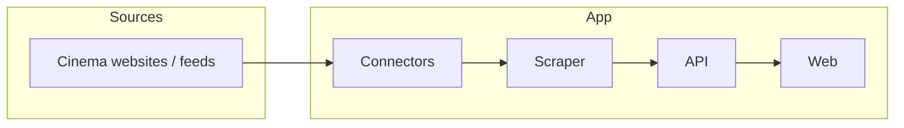

# CinePosto

Scraper, API, and web app for Umbria cinema showtimes (.NET + Azure).

## Overview

CinePosto collects cinema schedules in Umbria and exposes them
through an API with a web frontend.

TODO: add a one-paragraph project summary once the scope is final.

## Project status

Early stage. The Domain, two cinema connectors (Clarici and UCI), a minimal
Scraper, a minimal API and a web frontend exist, and the whole system runs
locally with Docker. The Azure deployment does not exist yet.

- [x] Repository structure
- [x] Domain model (scraped models, title normalization, persistence abstractions)
- [x] First cinema connector (Clarici)
- [x] Second cinema connector (UCI)
- [x] Scraper (minimal: runs the connectors and stores the result in SQLite)
- [x] API (minimal: cinemas, films, showings, health, admin dataset info)
- [x] Local run with Docker Compose and a smoke test
- [x] Web frontend (`web/`, served by the API; Italian and English)
- [ ] Azure deployment (Bicep + GitHub Actions) — TODO

## Architecture

TODO: describe the layers (Domain, Infrastructure, Connectors,
Scraper, Api, Web) once implemented.



## Repository structure

```text
src/      # .NET projects: Domain, Infrastructure, Connectors, Scraper, Api
web/      # web frontend: HTML, CSS, JavaScript, texts in web/i18n (it, en), tests in web/tests
tests/    # automated tests with saved fixtures (no live network)
docs/     # analysis, UX, and architecture notes
infra/    # Bicep files for Azure deployment — TODO
scripts/  # local smoke test (smoke.sh, smoke.ps1)
.github/  # GitHub Actions workflows and templates
docker-compose.yml, .env.example   # local run with Docker
```

See `AGENTS.md` for working rules (branches, commits, tests, secrets).

## Getting started

Prerequisites: the .NET SDK pinned in `global.json` (10.0.300), Docker with
the Compose plugin to run the system locally, and Node.js 22 or later to run
the frontend tests (no package is installed).

```bash
dotnet build
dotnet test
node --test "web/tests/*.test.mjs"    # frontend unit tests
```

To run the API without Docker, point it to the frontend folder:
`WEB_ROOT=web ADMIN_TOKEN=... dotnet run --project src/CinePosto.Api`.

Configuration uses environment variables. Production secrets live
in Azure Key Vault. Never commit secrets to the repo.

## Running locally with Docker

This runs the API and the scraper in containers on your machine. Nothing
is deployed to Azure. You need Docker with the Compose plugin
(`docker compose version`).

1. **Configure.** Copy the template and set the admin token. There is no
   default token, and the API refuses to start without one (at least 16
   characters). `.env` is ignored by git.

   ```bash
   cp .env.example .env          # PowerShell: Copy-Item .env.example .env
   openssl rand -hex 32          # put the output in ADMIN_TOKEN=
   ```

2. **Start the API.** The image is built the first time.

   ```bash
   docker compose up -d --build
   curl http://localhost:8080/health      # Healthy
   ```

3. **Fill the database.** The scraper runs once and exits. The default
   mode, `SCRAPER_MODE=fixtures`, reads saved responses from
   `tests/CinePosto.Connectors.Tests/Golden` (mounted read-only) and never
   uses the network. It reads one saved case per cinema: `SCRAPER_FIXTURES_CASE`
   for Clarici and `SCRAPER_UCI_FIXTURES_CASE` for UCI. The days of the run come
   from the Clarici case, and the UCI case covers the same days. The database is
   created or migrated automatically.

   ```bash
   docker compose run --rm scraper
   ```

4. **Open the web app.** Go to <http://localhost:8080> (the port is `API_PORT`).
   The API serves the frontend, so it is one container on one address. The
   button in the top bar switches between Italian and English; the browser
   language is used the first time.

   The saved responses are dated 2026-09-22 and 2026-09-25, which is in the
   past. The home therefore opens on the closest day that has data and shows
   a "data is out of date" notice. The days from today onwards are empty.
   Both are expected with fixtures. Posters are placeholders because the
   fixtures point to addresses that do not exist.

5. **Or call the API directly.**

   ```bash
   curl http://localhost:8080/api/v1/cinemas
   curl http://localhost:8080/api/v1/films
   curl http://localhost:8080/api/v1/showings
   curl -H "X-Admin-Token: $ADMIN_TOKEN" http://localhost:8080/api/v1/admin/dataset-info
   ```

   `?date=` with today's date returns nothing for the same reason. Use a date
   from the fixtures, such as `?date=2026-09-22`.

6. **Stop.** `docker compose down` keeps the database in the `data` volume.
   `docker compose down -v` deletes it too.

Notes:

- Every `docker compose` command, including `run scraper`, needs
  `ADMIN_TOKEN` to be set, because Compose reads the whole file.
- `SCRAPER_MODE=live` calls the real website of every registered cinema
  (Clarici and UCI). Check the terms of use and `robots.txt` of each one
  first, and set `SCRAPER_USER_AGENT` to a value that identifies you. The mode
  has no default on purpose. The UCI data comes from an undocumented backend
  API that the legacy project found by watching the site's own requests, so it
  can change without notice, and its terms of use are still an open question
  (`docs/01-analysis/requirements.md`, open questions).
- Ports, the database path and the fixtures folder are set in `.env`. Every
  variable is described in `.env.example`.

### Smoke test

`scripts/smoke.sh` (Linux, macOS, Git Bash, WSL) and `scripts/smoke.ps1`
(Windows PowerShell and PowerShell 7) build the images, check that the API
refuses to start without a token, start it, run the scraper on the saved
fixtures and call the main endpoints with curl. They also check that a second
scraper run changes nothing and that a failing source keeps the last known
showings. They use their own Compose project and a temporary token, so they
never touch your `.env` or your data, and they remove what they create.

```bash
scripts/smoke.sh
powershell -ExecutionPolicy Bypass -File scripts\smoke.ps1   # Windows
```

A failing check prints the logs of the service involved and ends with a
specific non-zero exit code (listed at the top of each script). The smoke test
publishes the API on port 18080; change it with `SMOKE_API_PORT`. CI runs it on
every pull request.

### What changes on Azure

This section describes the plan. None of it is implemented yet.

- **Secrets.** `ADMIN_TOKEN` and any API key come from Azure Key Vault, not
  from `.env`. The app reads them from environment variables in both cases.
- **Database.** The SQLite file in a Docker volume is for local runs only.
  SQLite on a network file share (Azure Files) is not reliable because of file
  locking, and two instances cannot safely share one file, so Azure needs a
  managed database. It is not decided yet (see ADR 0003). The Domain does not
  depend on it, but the EF Core migrations will probably be generated again for
  the new provider.
- **Scraper.** It becomes a scheduled job (at least every 24 hours) in `live`
  mode, not a command run by hand. The fixtures mount is not used.
- **Images.** CI builds them without pushing. In Azure they are pushed to a
  registry from the pipeline.
- **Network.** The platform terminates HTTPS and uses `/health` as the
  health probe. `API_PORT` only changes the port published on your machine.
- **Infrastructure.** Everything is described in Bicep under `infra/`, which
  is still empty.

## Roadmap

- TODO: define milestones (first connector, API v1, web v1, Azure deploy).
- TODO: list target cinemas.

## Credits
CinePosto was originally developed as a team class project by Yonas Habtetsadik Burka, Elio Casiola, Andrea Cestelli, Emanuele Ceccariglia. 
This repository is a from-scratch rewrite in C#/.NET by Yonas Habtetsadik Burka.

## License

MIT. See [LICENSE](LICENSE).
